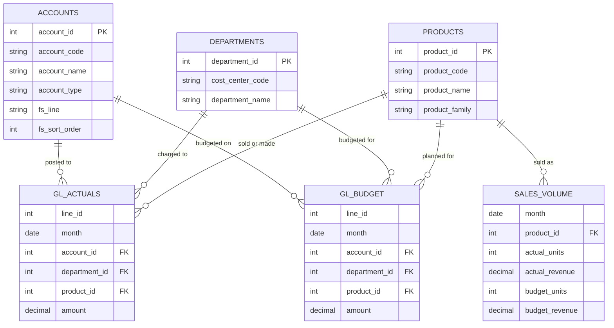

# Where did Q3 profit go?

**Penang Microworks Sdn Bhd** is a fictional Penang maker of electronic modules. Its Q3 2026 operating profit missed budget. This case study explains why, using SQL, an FS-format P&L and a short CFO memo.

## The company

- **Products:** 6 products in 3 families: sensor modules (high margin), power modules (low margin), connectivity boards (middle)
- **Cost centers:** Engineering, Operations, Sales & Marketing, General and Administrative
- **Period:** FY2026 budget for Jan–Dec; actuals for Jan–Sep
- **Size:** about RM98m budgeted revenue, 15% operating margin

## Folder layout

```
data/      generated CSV files (the "ERP extract")
scripts/   generate_data.py, the data generator
sql/       table setup, load script, and one query file per question
```

## How to run it (Mac)

```
# 1. Create the data (only needed if you change the generator)
python3 scripts/generate_data.py

# 2. Create the database and tables, then load the CSVs
createdb penang_microworks
psql penang_microworks -f sql/00_create_tables.sql
psql penang_microworks -f sql/01_load_data.sql

# 3. Post the adjusting entries, then build the clean GL view
psql penang_microworks -f sql/02_adjustments.sql
psql penang_microworks -f sql/03_gl_actuals_clean.sql
```

Run these from inside this folder, since the load script uses relative paths.

## Tables

| Table | Grain | Notes |
| --- | --- | --- |
| accounts | One row per GL account | `fs_line` and `fs_sort_order` drive the P&L layout |
| departments | One row per cost center | |
| products | One row per product | |
| gl_actuals | One row per journal line | Jan–Sep; debits positive, credits negative |
| gl_budget | One row per budget line | Jan–Dec; same shape as gl_actuals |
| sales_volume | One row per product per month | Units and revenue for the PVM bridge; actuals NULL for Oct–Dec |

## Schema



## Data quality

The raw GL tables have no keys on purpose, like a real ERP extract. Run the data quality checks in [data-quality.md](data-quality.md) before any analysis.

*(Findings and treatment go here.)*

## Questions

The case study questions, definitions and solutions are in [questions-and-solutions.md](questions-and-solutions.md). All amounts are in Malaysian Ringgit (RM).

## Findings

*(CFO memo summary goes here.)*
