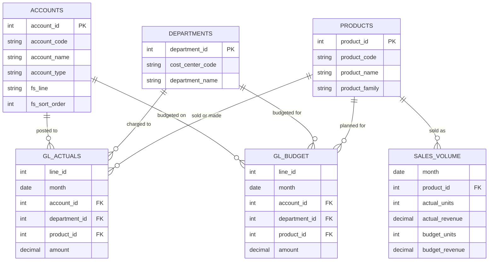

# 🔌 Penang Microworks: Where did Q3 profit go?

## Table of Contents

- [The story](#the-story)
- [Schema](#schema)
- [P&L at a glance](#pl-at-a-glance)
- [Case study questions](#case-study-questions)
- [Case study solution](#case-study-solution)

## The story

Q3 operating profit missed budget. This case study is the monthly variance analysis write-up that explains why, in SQL, an FS-format report and a short CFO memo.

Before any of the questions, the GL extract went through 7 data quality checks. See [data-quality.md](./data-quality.md).

## Schema

Six tables: three lookup tables (accounts, departments, products) and three fact tables (GL actuals, GL budget and monthly sales volume). The questions read actuals from `gl_actuals_clean`, a view of `gl_actuals` after the data quality adjustments.



## P&L at a glance

Clean actuals (`gl_actuals_clean`) against budget in FS format. All amounts in RM. A negative variance is bad for profit.

### Q3 (July to September 2026)

| P&L line | Actual | Budget | Variance | Var % |
| --- | ---: | ---: | ---: | ---: |
| **Revenue** | **24,183,231** | **25,058,385** | **-875,154** | **-3.5** |
| *Cost of sales* | | | | |
| &nbsp;&nbsp;&nbsp;&nbsp;Direct materials | 11,370,222 | 11,486,353 | 116,130 | 1.0 |
| &nbsp;&nbsp;&nbsp;&nbsp;Direct labour | 1,949,181 | 1,969,089 | 19,908 | 1.0 |
| &nbsp;&nbsp;&nbsp;&nbsp;Manufacturing overhead | 2,923,771 | 2,953,634 | 29,862 | 1.0 |
| **(-) Cost of sales** | **16,243,175** | **16,409,075** | **165,900** | **1.0** |
| **Gross profit** | **7,940,056** | **8,649,310** | **-709,254** | **-8.2** |
| *Operating expenses* | | | | |
| &nbsp;&nbsp;&nbsp;&nbsp;*Staff costs* | | | | |
| &nbsp;&nbsp;&nbsp;&nbsp;&nbsp;&nbsp;&nbsp;&nbsp;Engineering | 1,563,523 | 1,385,100 | -178,423 | -12.9 |
| &nbsp;&nbsp;&nbsp;&nbsp;&nbsp;&nbsp;&nbsp;&nbsp;Operations | 511,785 | 513,000 | 1,215 | 0.2 |
| &nbsp;&nbsp;&nbsp;&nbsp;&nbsp;&nbsp;&nbsp;&nbsp;Sales & Marketing | 410,605 | 410,400 | -205 | 0.0 |
| &nbsp;&nbsp;&nbsp;&nbsp;&nbsp;&nbsp;&nbsp;&nbsp;General and Administrative | 432,380 | 430,920 | -1,460 | -0.3 |
| &nbsp;&nbsp;&nbsp;&nbsp;Rental and utilities | 597,058 | 600,000 | 2,942 | 0.5 |
| &nbsp;&nbsp;&nbsp;&nbsp;Depreciation | 660,000 | 660,000 | 0 | 0.0 |
| &nbsp;&nbsp;&nbsp;&nbsp;Other operating expenses | 604,038 | 600,000 | -4,038 | -0.7 |
| **(-) Total operating expenses** | **4,779,389** | **4,599,420** | **-179,969** | **-3.9** |
| **Operating profit** | **3,160,668** | **4,049,890** | **-889,222** | **-22.0** |

### Year to date (January to September 2026)

| P&L line | Actual | Budget | Variance | Var % |
| --- | ---: | ---: | ---: | ---: |
| **Revenue** | **69,717,966** | **71,133,480** | **-1,415,514** | **-2.0** |
| *Cost of sales* | | | | |
| &nbsp;&nbsp;&nbsp;&nbsp;Direct materials | 32,466,442 | 32,606,420 | 139,978 | 0.4 |
| &nbsp;&nbsp;&nbsp;&nbsp;Direct labour | 5,565,676 | 5,589,672 | 23,996 | 0.4 |
| &nbsp;&nbsp;&nbsp;&nbsp;Manufacturing overhead | 8,348,514 | 8,384,508 | 35,994 | 0.4 |
| **(-) Cost of sales** | **46,380,632** | **46,580,600** | **199,968** | **0.4** |
| **Gross profit** | **23,337,335** | **24,552,880** | **-1,215,545** | **-5.0** |
| *Operating expenses* | | | | |
| &nbsp;&nbsp;&nbsp;&nbsp;*Staff costs* | | | | |
| &nbsp;&nbsp;&nbsp;&nbsp;&nbsp;&nbsp;&nbsp;&nbsp;Engineering | 4,400,741 | 4,155,300 | -245,441 | -5.9 |
| &nbsp;&nbsp;&nbsp;&nbsp;&nbsp;&nbsp;&nbsp;&nbsp;Operations | 1,541,538 | 1,539,000 | -2,538 | -0.2 |
| &nbsp;&nbsp;&nbsp;&nbsp;&nbsp;&nbsp;&nbsp;&nbsp;Sales & Marketing | 1,232,937 | 1,231,200 | -1,737 | -0.1 |
| &nbsp;&nbsp;&nbsp;&nbsp;&nbsp;&nbsp;&nbsp;&nbsp;General and Administrative | 1,293,341 | 1,292,760 | -581 | 0.0 |
| &nbsp;&nbsp;&nbsp;&nbsp;Rental and utilities | 1,824,110 | 1,800,000 | -24,110 | -1.3 |
| &nbsp;&nbsp;&nbsp;&nbsp;Depreciation | 1,980,000 | 1,980,000 | 0 | 0.0 |
| &nbsp;&nbsp;&nbsp;&nbsp;Other operating expenses | 1,969,595 | 1,800,000 | -169,595 | -9.4 |
| **(-) Total operating expenses** | **14,242,262** | **13,798,260** | **-444,002** | **-3.2** |
| **Operating profit** | **9,095,073** | **10,754,620** | **-1,659,547** | **-15.4** |

***

All amounts are in Malaysian Ringgit (RM).

Definitions used throughout:
- **Actuals** come from `gl_actuals_clean`, not `gl_actuals`. It has the adjusting entries and leaves out the 3 lines on hold.
- **Budget** comes from `gl_budget`.
- **Q3** = July to September 2026. **YTD** = January to September 2026.
- **Sign convention:** the GL stores debits as positive and credits as negative, so revenue is negative and costs are positive. Flip the sign (`-SUM(amount)`) to show revenue and profit as positive numbers.
- **Variance** = actual − budget, shown so that a positive number is good for profit and a negative number is bad: revenue above budget is positive, costs above budget are negative.
- **Gross profit** = revenue − cost of sales. **Operating profit** = gross profit − operating expenses.
- Revenue and cost of sales lines carry a `product_id`. Opex lines carry a `department_id`.

## Case Study Questions

### Core Questions

1. [Revenue by Product Family](#1-revenue-by-product-family): Which product families drove the revenue miss? Return product family, Q3 actual revenue, budget revenue, variance (RM) and variance %, sorted by the most negative variance first.

2. [Gross Margin by Product Family](#2-gross-margin-by-product-family): Q1 showed revenue shifting away from sensor modules towards connectivity boards. Did that shift hurt profit more than the revenue figure suggests? Return product family, actual and budget gross profit, and actual and budget gross margin % (rounded to 1 decimal place).

3. [Opex by Cost Center](#3-opex-by-cost-center): Which departments overspent in Q3? Return department name, actual opex, budget opex, variance (RM) and variance %, sorted by the biggest overspend first.

4. [Monthly Trend](#4-monthly-trend): Was Q3 a sudden drop or a slow slide? For each month January to September, return actual and budget operating profit, the monthly variance, and the YTD cumulative variance (using a window function).

### Advanced Questions

5. [Price-Volume-Mix Bridge](#5-price-volume-mix-bridge): Split the Q3 product revenue variance into price, volume and mix effects by product, using `sales_volume`. Return product code, price effect, volume effect, mix effect and total variance, plus a total row. The three effects should add up to actual − budget revenue.

   | Effect | Formula (per product) |
   | --- | --- |
   | Price | (actual price − budget price) × actual units |
   | Volume | (total actual units × budget share of units − budget units) × budget price |
   | Mix | (actual units − total actual units × budget share of units) × budget price |

   Price = revenue ÷ units. Budget share of units = the product's budget units ÷ total budget units.

6. [Operating Profit Bridge](#6-operating-profit-bridge): Walk from Q3 budget operating profit to actual operating profit in one table, ready for a waterfall chart. Return one row per step: budget operating profit, price, volume, mix, sales returns (account 4100, which isn't in `sales_volume`), cost of sales, each opex fs_line, and actual operating profit. Each step should show its RM impact, and the steps should add up from budget to actual.

7. [Full-Year Forecast](#7-full-year-forecast): Where will FY2026 land? Build a simple forecast as YTD actuals (Jan–Sep) plus budget for October to December. Return revenue, gross profit, opex and operating profit for the forecast and the full-year budget, with the variance between them.

8. [CFO Memo](#8-cfo-memo): Using your answers above, write a short memo (no more than 200 words) to the CFO: how much Q3 missed by, the top three drivers with their RM impact, and what the forecast means for the full year.

## Case Study Solution

### 1. Revenue by Product Family

Which product families drove the revenue miss? Return product family, Q3 actual revenue, budget revenue, variance (RM) and variance %, sorted by the most negative variance first.

```sql
WITH revenue_actuals AS (
    SELECT
        p.product_family,
        -SUM(g.amount) AS actual_revenue
    FROM gl_actuals_clean AS g
    INNER JOIN accounts AS a
        ON g.account_id = a.account_id
    INNER JOIN products AS p
        ON g.product_id = p.product_id
    WHERE a.account_type = 'Revenue'
        AND (month >= '2026-07-01' AND month <= '2026-09-30')
    GROUP BY p.product_family
)
, revenue_budget AS (
    SELECT
        p.product_family,
        -SUM(b.amount) AS budget_revenue
    FROM gl_budget AS b
    INNER JOIN accounts AS a
        ON b.account_id = a.account_id
    INNER JOIN products AS p
        ON b.product_id = p.product_id
    WHERE a.account_type = 'Revenue'
        AND (month >= '2026-07-01' AND month <= '2026-09-30')
    GROUP BY p.product_family
)

SELECT 
    ra.product_family,
    ra.actual_revenue,
    rb.budget_revenue,
    ra.actual_revenue - rb.budget_revenue AS variance,
    ROUND(100.0 * ((ra.actual_revenue - rb.budget_revenue)/rb.budget_revenue),1) AS variance_pct
FROM revenue_actuals AS ra
INNER JOIN revenue_budget AS rb
    ON ra.product_family = rb.product_family
ORDER BY variance ASC;
```

**✅ Result:**
```
   product_family    | actual_revenue | budget_revenue |  variance   | variance_pct 
---------------------+----------------+----------------+-------------+--------------
 Sensor modules      |     8565644.60 |     9636660.00 | -1071015.40 |        -11.1
 Power modules       |     8803116.29 |     9207000.00 |  -403883.71 |         -4.4
 Connectivity boards |     6814470.36 |     6214725.00 |   599745.36 |          9.7
(3 rows)
```

**📊 Commentary:** Total actual and budget revenue tie to the P&L figures. Revenue missed budget by RM875k, but that's the net figure. 

When we drill down by product family, sensor modules alone missed by RM1.07m (-11.1%) and power modules by RM0.4k (-4.4%). Connectivity boards beat budget by RM600k (9.7%) which offset the two negatives and made the total variance smaller. 

### 2. Gross Margin by Product Family

Q1 showed revenue shifting away from sensor modules towards connectivity boards. Did that shift hurt profit more than the revenue figure suggests? Return product family, actual and budget gross profit, and actual and budget gross margin % (rounded to 1 decimal place).

```sql
WITH actuals_gross AS (
    SELECT
        p.product_family,
        -SUM(CASE WHEN a.account_type = 'Revenue' THEN g.amount END) AS actual_revenue,
        SUM(CASE WHEN a.account_type = 'COGS' THEN g.amount END) AS actual_cogs
    FROM gl_actuals_clean AS g
    INNER JOIN accounts AS a
        ON g.account_id = a.account_id
    INNER JOIN products AS p
        ON g.product_id = p.product_id
    WHERE (month >= '2026-07-01' AND month <= '2026-09-30')
    GROUP BY p.product_family
)
, budget_gross AS (
    SELECT
        p.product_family,
        -SUM(CASE WHEN a.account_type = 'Revenue' THEN b.amount END) AS budget_revenue,
        SUM(CASE WHEN a.account_type = 'COGS' THEN b.amount END) AS budget_cogs
    FROM gl_budget AS b
    INNER JOIN accounts AS a
        ON b.account_id = a.account_id
    INNER JOIN products AS p
        ON b.product_id = p.product_id
    WHERE (month >= '2026-07-01' AND month <= '2026-09-30')
    GROUP BY p.product_family
)

SELECT 
    ag.product_family,
    ag.actual_revenue - ag.actual_cogs AS actual_gross_profit,
    bg.budget_revenue - bg.budget_cogs AS budget_gross_profit,
    ROUND(100.0*((ag.actual_revenue - ag.actual_cogs)/ag.actual_revenue),1) AS actual_gross_margin_pct,
    ROUND(100.0*((bg.budget_revenue - bg.budget_cogs)/bg.budget_revenue),1) AS budget_gross_margin_pct
FROM actuals_gross AS ag
INNER JOIN budget_gross AS bg
    ON ag.product_family = bg.product_family
ORDER BY actual_gross_margin_pct DESC;
```

**✅ Result:**
```
   product_family    | actual_gross_profit | budget_gross_profit | actual_gross_margin_pct | budget_gross_margin_pct 
---------------------+---------------------+---------------------+-------------------------+-------------------------
 Sensor modules      |          3806220.51 |          4282960.00 |                    44.4 |                    44.4
 Connectivity boards |          2344780.51 |          2134350.00 |                    34.4 |                    34.3
 Power modules       |          1789055.37 |          2232000.00 |                    20.3 |                    24.2
(3 rows)
```

**📊 Commentary:**

Total revenue is down by 3.5%, however gross profit fell by 8.2%, more than twice as much as revenue, driven by sensor modules and power modules. 

**Sensor modules: Volume effect, not price**

Units fell about 11% and 11% respectively for both products while prices for SEN-100 increased by 0.22% from RM85.00 to RM85.19 and remained at RM120.00 for SEN-200. 

We missed revenue by RM591,893 then deduct RM10,332, assuming the actual price per unit is RM85.00, the net effect is RM602,225. Total miss = price effect + volume effect -> 7,085 fewer units. 

| SEN-100, Q3 | RM |
| --- | ---: |
| Total revenue miss | -591,893 |
| Price effect (RM0.19 higher) | +10,332 |
| Volume effect (7,085 fewer units × RM85) | -602,225 |

<details>
<summary>Show query: sensor modules price vs volume</summary>

```sql
WITH sensor_modules AS (
    SELECT 
        sv.product_id,
        p.product_code,
        p.product_name,
        p.product_family,
        SUM(sv.actual_units) AS total_actual_units,
        SUM(sv.actual_revenue) AS total_actual_revenue,
        SUM(sv.budget_units) AS total_budget_units,
        SUM(sv.budget_revenue) AS total_budget_revenue
    FROM sales_volume AS sv
    INNER JOIN products AS p
        ON sv.product_id = p.product_id
    WHERE (month >= '2026-07-01' AND month <= '2026-09-30')
        AND product_family = 'Sensor modules'
    GROUP BY 
        sv.product_id,
        p.product_code,
        p.product_name,
        p.product_family
)

SELECT 
    product_id,
    product_code,
    product_name,
    product_family,
    ROUND((total_actual_revenue/total_actual_units),2) AS act_price_unit,
    total_actual_units,
    total_actual_revenue,
    ROUND((total_budget_revenue/total_budget_units),2) AS budget_price_unit,
    total_budget_units,
    total_budget_revenue,
    ROUND(100.0*(total_actual_units - total_budget_units)/total_budget_units,2) AS unit_var_pct,
    ROUND(100.0*(total_actual_revenue - total_budget_revenue)/total_budget_revenue,2) AS revenue_var_pct
FROM sensor_modules AS sm;
```

Sensor price vs. volume:
```
 product_id | product_code |       product_name        | product_family | act_price_unit | total_actual_units | total_actual_revenue | budget_price_unit | total_budget_units | total_budget_revenue| unit_var_pct | revenue_var_pct 
------------+--------------+---------------------------+----------------+----------------+--------------------+----------------------+-------------------+--------------------+----------------------+--------------+-----------------
          1 | SEN-100      | Temperature sensor module | Sensor modules |          85.19 |              54915 |           4678107.09 |             85.00 |              62000 |           5270000.00|       -11.43 |          -11.23
          2 | SEN-200      | Pressure sensor module    | Sensor modules |         120.00 |              33133 |           3975844.01 |            120.00 |              37200 |           4464000.00|       -10.93 |          -10.94
(2 rows)
```

</details>

**Power modules: A margin problem**

Margin fell from 24.2% to 20.3%. 

PWR-100 dropped its price by 5.22% (RM3.13 difference), but sold 1,522 more units. Did the price cut pay off? Net effect is a small revenue increase of RM4,763.86 (RM3.13 x 1,522 units).

However for PWR-200, the price cut didn't pay off. It also sold at a lower price by 4.77% (RM7.16 difference), but sold 181 fewer units giving a negative effect: -RM1,295.96.

The impact of the price difference is RM295,853.86 and RM176,272.04 respectively, loss of revenue which amounts to RM472,125.90.

| Q3 | PWR-100, RM | PWR-200, RM |
| --- | --- | --- |
| Total revenue miss | -204,456.13 | -203,388.72 | 
| Price effect (RM3.13 lower) / (RM7.16 lower) | -RM295,776.13 | -RM176,238.72 |
| Volume effect (1,522 more units × RM60) / (181 fewer units × RM150)| +RM91,320.00 | -RM27,150.00 |

<details>
<summary>Show query: power modules price vs volume</summary>

```sql
WITH power_modules AS (
    SELECT 
        sv.product_id,
        p.product_code,
        p.product_name,
        p.product_family,
        SUM(sv.actual_units) AS total_actual_units,
        SUM(sv.actual_revenue) AS total_actual_revenue,
        SUM(sv.budget_units) AS total_budget_units,
        SUM(sv.budget_revenue) AS total_budget_revenue
    FROM sales_volume AS sv
    INNER JOIN products AS p
        ON sv.product_id = p.product_id
    WHERE (month >= '2026-07-01' AND month <= '2026-09-30')
        AND product_family = 'Power modules'
    GROUP BY 
        sv.product_id,
        p.product_code,
        p.product_name,
        p.product_family
)

SELECT 
    product_id,
    product_code,
    product_name,
    product_family,
    ROUND((total_actual_revenue/total_actual_units),2) AS act_price_unit,
    total_actual_units,
    total_actual_revenue,
    ROUND((total_budget_revenue/total_budget_units),2) AS budget_price_unit,
    total_budget_units,
    total_budget_revenue,
    ROUND(100.0*(total_actual_units - total_budget_units)/total_budget_units,2) AS unit_var_pct,
    ROUND(100.0*(total_actual_revenue - total_budget_revenue)/total_budget_revenue,2) AS revenue_var_pct
FROM sensor_modules AS sm;
```


``` product_id | product_code |       product_name        | product_family | act_price_unit | total_actual_units | total_actual_revenue | budget_price_unit | total_budget_units | total_budget_revenue| unit_var_pct | revenue_var_pct 
------------+--------------+---------------------------+----------------+----------------+--------------------+----------------------+-------------------+--------------------+----------------------+--------------+-----------------
          3 | PWR-100      | DC-DC converter module    | Power modules  |          56.87 |              94522 |           5375543.87 |             60.00 |              93000 |           5580000.00|         1.64 |           -3.66
          4 | PWR-200      | Battery management module | Power modules  |         142.84 |              24619 |           3516611.28 |            150.00 |              24800 |           3720000.00|        -0.73 |           -5.47
(2 rows)
```

</details>


### 3. Opex by Cost Center

Which departments overspent in Q3? Return department name, actual opex, budget opex, variance (RM) and variance %, sorted by the biggest overspend first.

```sql

```


**✅ Result:**

### 4. Monthly Trend

Was Q3 a sudden drop or a slow slide? For each month January to September, return actual and budget operating profit, the monthly variance, and the YTD cumulative variance (using a window function).

```sql

```


**✅ Result:**

### 5. Price-Volume-Mix Bridge

Split the Q3 product revenue variance into price, volume and mix effects by product, using `sales_volume`. Return product code, price effect, volume effect, mix effect and total variance, plus a total row. The three effects should add up to actual − budget revenue.

| Effect | Formula (per product) |
| --- | --- |
| Price | (actual price − budget price) × actual units |
| Volume | (total actual units × budget share of units − budget units) × budget price |
| Mix | (actual units − total actual units × budget share of units) × budget price |

Price = revenue ÷ units. Budget share of units = the product's budget units ÷ total budget units.

```sql

```


**✅ Result:**

### 6. Operating Profit Bridge

Walk from Q3 budget operating profit to actual operating profit in one table, ready for a waterfall chart. Return one row per step: budget operating profit, price, volume, mix, sales returns (account 4100, which isn't in `sales_volume`), cost of sales, each opex fs_line, and actual operating profit. Each step should show its RM impact, and the steps should add up from budget to actual.

```sql

```


**✅ Result:**

### 7. Full-Year Forecast

Where will FY2026 land? Build a simple forecast as YTD actuals (Jan–Sep) plus budget for October to December. Return revenue, gross profit, opex and operating profit for the forecast and the full-year budget, with the variance between them.

```sql

```


**✅ Result:**

### 8. CFO Memo

Using your answers above, write a short memo (no more than 200 words) to the CFO: how much Q3 missed by, the top three drivers with their RM impact, and what the forecast means for the full year.

**✅ Memo:**
